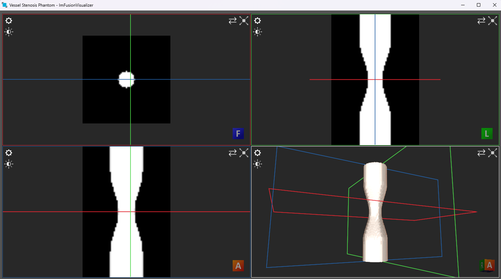
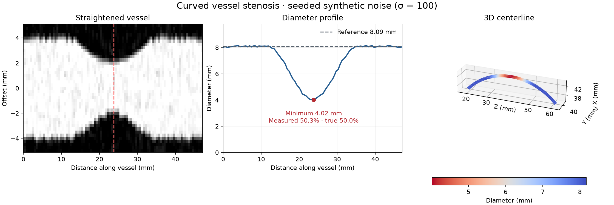
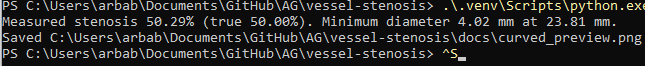
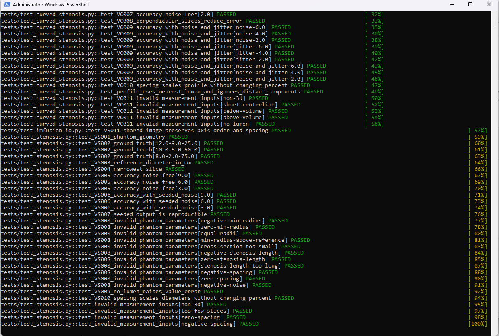

# Vessel Stenosis Measurement

My work with interventional devices made me curious about how vessel narrowing is measured, so I started by building straight and curved synthetic vessels with known narrowing. I then built a desktop tool that lets me pick two points in an ImageCAS coronary artery mask, trace the vessel between them, and see where its diameter is smallest. The tool measures the geometry of the supplied segmentation and does not detect or grade disease.

[ImageCAS dataset (non-commercial use)](https://github.com/XiaoweiXu/ImageCAS-A-Large-Scale-Dataset-and-Benchmark-for-Coronary-Artery-Segmentation-based-on-CT) · [Zeng et al., *ImageCAS: A Large-Scale Dataset and Benchmark for Coronary Artery Segmentation based on Computed Tomography Angiography Images*](https://doi.org/10.1016/j.compmedimag.2023.102287)

I generated a synthetic 3D vessel with a known narrowing, then use NumPy to threshold each slice and estimate its equivalent circular diameter. I compared the smallest diameter with the median diameter from the first and last ten slices to calculate percent diameter stenosis.

## ImFusion viewer

## Vessel Measurement

## Requirements and tests

| ID | Requirement | Test |
| --- | --- | --- |
| VS-001 | Generate a straight vessel along axis 0 with known reference and minimum radii. | `test_VS001_phantom_geometry` |
| VS-002 | Calculate ground truth as `(1 - min_radius / ref_radius) * 100`. | `test_VS002_ground_truth` |
| VS-003 | Report the reference diameter in mm within 5% of the expected diameter. | `test_VS003_reference_diameter_in_mm` |
| VS-004 | Locate the narrowest slice within one slice of the center. | `test_VS004_narrowest_slice` |
| VS-005 | Measure 25%, 50%, and 75% stenosis within ±3 percentage points without noise. | `test_VS005_accuracy_noise_free` |
| VS-006 | Meet the same tolerance with seeded Gaussian noise at σ = 100. | `test_VS006_accuracy_with_seeded_noise` |
| VS-007 | Reproduce the volume and measurement for identical inputs and seed. | `test_VS007_seeded_output_is_reproducible` |
| VS-008 | Reject invalid phantom parameters with `ValueError`. | `test_VS008_invalid_phantom_parameters` |
| VS-009 | Raise `ValueError` for a volume with no lumen. | `test_VS009_no_lumen_raises_value_error` |
| VS-010 | Scale diameters with voxel spacing while keeping percent stenosis constant. | `test_VS010_spacing_scales_diameters_without_changing_percent` |
| VS-011 | Preserve array axis order and voxel spacing through a `SharedImage` round trip. | `test_VS011_shared_image_preserves_axis_order_and_spacing` |

VS-001 through VS-010 are in [`tests/test_stenosis.py`](tests/test_stenosis.py). VS-011 is in [`tests/test_imfusion_io.py`](tests/test_imfusion_io.py).

## Curved vessel

I bend the synthetic vessel into a circular arc with a known narrowing. I took slices perpendicular to the centerline, threshold the lumen, and use its area to estimate the diameter and compared the smallest diameter with the median diameter from the first and last 15% of the path.

### Curved-vessel requirements

| ID | What I checked | Test |
| --- | --- | --- |
| VC-001 | Circular arc, cosine narrowing, and ground-truth stenosis | `test_VC001_curved_geometry_and_ground_truth` |
| VC-002 | Invalid phantom inputs raise `ValueError` | `test_VC002_invalid_curved_phantom_parameters` |
| VC-003 | Seeded Gaussian noise is reproducible | `test_VC003_seeded_gaussian_noise_is_reproducible` |
| VC-004 | Sample spacing and total arc length are within 1% | `test_VC004_resampling_preserves_arc_length_and_equal_spacing` |
| VC-005 | Perpendicular sections and orthonormal frames with no added twist | `test_VC005_frames_are_orthonormal_and_parallel_transported`, `test_VC005_sections_sample_the_perpendicular_plane` |
| VC-006 | Straight-vessel measurements agree within 1 percentage point | `test_VC006_matches_straight_vessel_measurement` |
| VC-007 | Noise-free stenosis is within 5 percentage points at 25%, 50%, and 75% | `test_VC007_accuracy_noise_free` |
| VC-008 | Perpendicular slices give a smaller error on the 50% curved phantom | `test_VC008_perpendicular_slices_reduce_error` |
| VC-009 | Accuracy with seeded noise (σ = 100), jitter up to 0.5 voxel, and both combined | `test_VC009_accuracy_with_noise_and_jitter` |
| VC-010 | Lengths and diameters scale with voxel spacing, and stenosis stays the same | `test_VC010_spacing_scales_centerline_and_sampling_lengths`, `test_VC010_spacing_scales_profile_without_changing_percent` |
| VC-011 | Invalid volumes, centerlines, and paths without lumen raise `ValueError` | `test_VC011_invalid_measurement_inputs` |

## Limits

I use synthetic vessels with circular lumens and uniform voxel spacing. The curved phantom has a large bend radius compared with the vessel radius, and the measurement uses intensity thresholding. I haven’t validated it on patient data. This is not a medical device. I use ImFusion for image conversion and a manual viewer check.

## Learning curve

- Voxelization gives the narrowing a short plateau where several slices have the same measured diameter. I pick the middle slice among the tied minima.
- The installed SDK documents image buffers in `(z, y, x, channels)` order and spacing in `(x, y, z)` order. I wrote the round-trip test with distinct dimensions and spacing values so an axis swap would be visible.
- The NumPy suite passed all 30 tests in 1.90 seconds. After adding ImFusion, the run finished with 30 passed and 1 skipped in 1.45 seconds. The SDK reported a missing license during that run. The screenshots show the phantom open in the viewer, and the automated round trip still needs a licensed test run.
- Some samples landed exactly at the threshold on the straight vessel. Shifting the measurement grid by a quarter voxel brought the result back in line with the original test.
- On the 50% curved phantom, perpendicular slicing had 0.44 percentage points of error. Axis-aligned slicing had 5.63.

